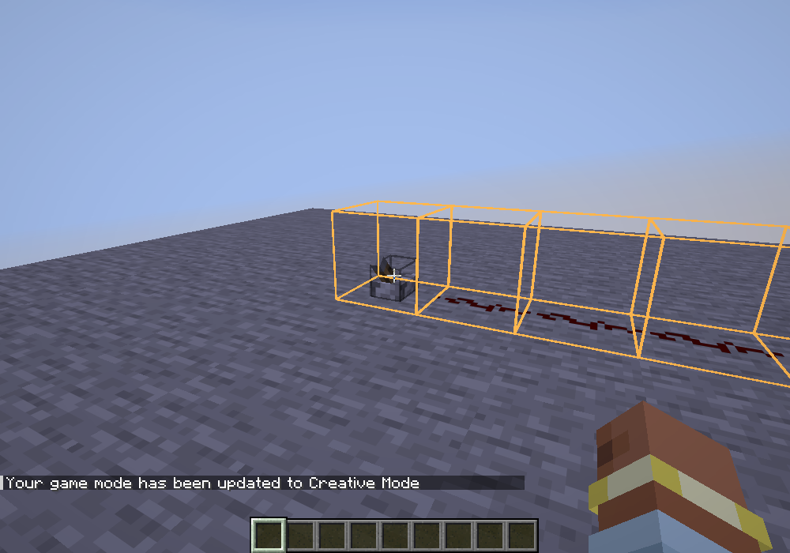
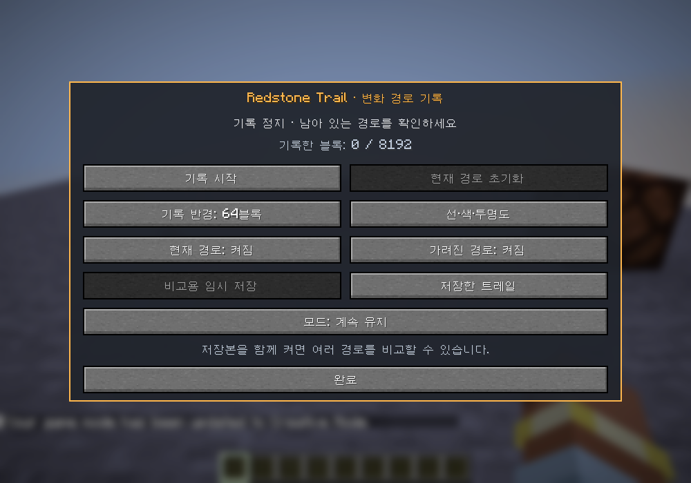

# Redstone Trail

Minecraft Java **26.2 / Fabric**용 독립 모드입니다. **기록 시작**을 누른 뒤 레버나 버튼을 작동하면,
상태가 변한 블록의 위치에 윤곽선이 누적됩니다. 트레일마다 **색·선 두께·투명도**를 바꾸고,
**여러 경로를 저장해 함께 비교**하거나 **설정한 시간과 방식으로 소멸**시킬 수 있습니다.



## 설치

- Minecraft Java Edition **26.2**
- Fabric Loader **0.19.5 이상**
- Fabric API **0.160.0+26.2** 또는 해당 게임 버전의 호환 버전
- Java **25 이상**

`redstone-trail-0.2.0.jar`와 Fabric API를 게임 프로필의 `mods` 폴더에 넣으세요. 이전 JAR는 새 버전으로 교체하세요.
`-sources.jar`는 개발용 소스이며 설치용이 아닙니다. Show Interaction이나 Feedback Flag 설치는 필요하지 않습니다.
서버 설치가 필요 없는 클라이언트 전용 모드이며, 표시와 기록은 본인에게만 적용됩니다.

## 사용 방법

1. 회로 근처에서 **`/rt`** 또는 **`/redstonetrail`**을 입력합니다.
2. 필요하면 기록 반경을 선택한 뒤 **기록 시작**을 누릅니다. 메뉴가 닫히면 레버나 버튼으로 회로를 작동하세요.
3. 변한 블록 위치에 윤곽선이 생깁니다. 기본 ‘계속 유지’ 모드에서는 한 번 꺼졌다 켜져도 계속 남습니다.
4. `/rt`로 메뉴를 다시 열고 **기록 정지**를 누르면 추가 기록만 멈춥니다.
5. **현재 경로 초기화**는 현재 기록 경로만 지우고 기록을 정지합니다. 비교용 저장본은 남습니다.



| 기능 | 동작 |
| --- | --- |
| 기록 시작 | 현재 위치를 중심으로 새 기록 시작. 기존 경로에도 이어서 누적 |
| 기록 정지 | 새 변화 수집만 중지. 일시적 모드의 남은 시간은 계속 흐름 |
| 현재 경로 초기화 | 현재 경로 삭제 및 정지. 비교용 저장본은 유지 |
| 기록 반경 | 16 / 32 / 64 / 128블록, 기본 64. 시작 위치 중심의 구형 범위이며 이동해도 중심은 고정 |
| 현재 경로 | 현재 작업의 표시만 켜기/끄기. 저장본의 표시와 독립 |
| 가려진 경로 | 벽 뒤에 있는 윤곽선 표시, 기본 켜짐 |
| 선·색·투명도 | 현재 경로의 외형 변경. 이미 그린 윤곽선에도 적용 |
| 비교용 임시 저장 | 현재 남아 있는 경로를 이름과 함께 별도로 보관 |
| 저장한 트레일 | 저장본별 보이기·숨기기·외형/이름 수정·삭제 |
| 모드 | 계속 유지 / 일시적 트레일과 시간·소멸 방식 설정 |

`/redstonetrail start`, `/redstonetrail stop` 및 `/rt start`, `/rt stop`도 사용할 수 있습니다.
메뉴 단축키는 기본 미지정이며, Minecraft **설정 → 조작 → 키 지정 → Redstone Trail**에서 지정합니다.
메뉴를 열어 둬도 싱글플레이 회로는 계속 동작합니다. F1로 HUD를 숨기면 윤곽선도 숨깁니다.

## 윤곽선 설정과 비교 저장

**선·색·투명도**에서 투명도 **0~100%**, 선 두께 **1~10**, RGB 슬라이더 또는 **6자리 색 코드**로 색을 정합니다.
화면 아래 미리보기로 확인한 뒤 **적용**을 누르면 이미 그려진 경로에도 반영됩니다. 취소/Escape는 변경을 버립니다.
투명도 0%는 불투명, 100%는 완전히 숨김입니다. 표시 설정은 기록을 지우거나 시간 계산을 멈추지 않습니다.

회로 A를 기록한 후 **비교용 임시 저장**으로 보관하고 현재 경로를 초기화하세요. 회로를 수정해 B를 기록하고
다른 색으로 저장하면 **저장한 트레일**에서 A/B를 함께 켜 비교할 수 있습니다.
각 저장본의 **선·색·투명도**는 저장 이후에도 바꿀 수 있으며 이름도 수정할 수 있습니다.
보이기/숨기기는 선택한 트레일에만 적용되고, 삭제는 확인 후 해당 저장본만 지웁니다.

저장본은 현재 경로의 복사본이므로 이후의 기록·초기화·색 변경에 영향받지 않습니다.
일시적 모드에서는 **저장 버튼을 누른 순간 남아 있는 위치**만 보관하며, 저장본 자체는 자동 소멸하지 않습니다.
‘임시 저장’한 비교본도 재접속 후 유지되고 직접 삭제할 때 제거됩니다. 같은 위치의 여러 윤곽선은 색을
구분할 수 있도록 크기를 조금 달리 표시하며 실제 기록 좌표는 바뀌지 않습니다.


## 일시적 트레일

**모드 → 일시적 트레일**을 켜고 유지 시간 **0.5~120초**와 사라지는 방식을 설정한 뒤 적용합니다.
각 블록의 **마지막 상태 변화 시점**을 기준으로 계산하므로 먼저 작동한 위치부터 사라집니다.
같은 위치가 다시 작동하면 그 블록만 시간이 갱신됩니다.

| 사라지는 방식 | 동작 |
| --- | --- |
| 유지 시간 동안 서서히 | 작동 직후부터 서서히 흐려져 설정한 유지 시간이 끝나면 완전히 사라짐 |
| 시간이 되면 바로 | 유지 시간 동안 같은 투명도로 보이다 시간이 끝나면 즉시 사라짐 |
| 시간이 된 뒤 서서히 | 유지 시간 동안 그대로 보인 뒤 **추가 0.1~10초** 동안 서서히 사라짐 |

예를 들어 유지 시간 5초, 만료 후 사라지는 시간 1초이면 세 번째 방식의 전체 수명은 6초입니다.
소멸 투명도와 사용자가 정한 투명도는 함께 적용됩니다. 실제 경과 시간을 쓰며 기록 정지, 숨기기, 메뉴와
일시 정지 중에도 시간이 흐릅니다. 저장본은 비교를 위해 유지됩니다.

일시적 모드를 처음 켜면 이미 남아 있는 현재 경로는 적용 시점부터 시간을 계산합니다. 같은 모드에서
시간이나 방식을 바꾸면 기존 작동 시점에 새 설정을 적용합니다. 이미 사라진 경로는 되살리지 않습니다.
‘계속 유지’로 바꾸면 그 순간 남아 있는 위치가 보존됩니다.
일시적 현재 경로는 차원 이동·접속 종료 시 비우고 재접속 때 복원하지 않습니다. 시간 설정과 비교용 저장본은 유지합니다.


## 어떤 경로를 기록하나요?

기록 중 **범위 안에서 서버가 보내 준 블록 종류·상태 변화**를 수집합니다. 레드스톤 가루의 세기,
중계기·비교기의 전원, 램프의 켜짐, 피스톤·문의 상태처럼 변화가 있는 위치가 대상입니다.
블록이 사라져도 그 좌표의 1블록 경계 윤곽선은 남습니다.

- 회로의 전기적 연결이나 신호의 방향을 추론하지 않습니다. 범위 안의 별개 회로, 설치·파괴, 물 흐름·작물 성장도 상태가 변하면 포함됩니다.
- **상태값이 변하지 않는 일반 고체 블록의 통전**과 서버가 전송하지 않은 아주 짧은 중간 상태는 감지할 수 없습니다.
- 현재 로딩된 청크에서 받은 개별/구역 블록 갱신을 사용합니다. 처음 청크가 로딩되는 것만으로 경로가 생기지 않습니다.
- 로컬 설치·사용 예측만으로 확정하지 않으며, 서버가 보낸 상태와 비교합니다.
- 청크가 다시 로딩될 때 부재 중 변화를 소급 추정하지 않습니다. 기존 경로는 보존합니다.
- 차원 이동·월드 종료 시 기록은 자동 정지하며, 저장된 경로는 각 차원에서 표시합니다.
- 보관함 내용, 표지판 글자 등 블록 엔티티 데이터는 추적하지 않습니다.
- 다른 플레이어가 만든 변화도 내 클라이언트에 전달되면 포함됩니다.

## 저장과 한도

현재 경로에 최대 **8,192개 위치**를 보관합니다. 같은 위치의 반복 변화는 하나의 윤곽선으로 합칩니다.
한도에서 새 위치가 추가되면 기존 경로를 보존하고 기록을 정지합니다. 원하면 초기화 후 다시 기록하세요.
비교용 저장은 월드/서버마다 **최대 16개 트레일**, 합계 **32,768개 위치**까지 지원합니다. 한도를 넘는 저장은
기존 자료를 덮어쓰지 않고 비활성화됩니다. 저장본 목록은 페이지 버튼으로 이동할 수 있습니다.
윤곽선은 현재 차원의 로딩된 청크에서 플레이어로부터 192블록 이내에 표시합니다.

경로와 반경·표시 설정은 게임 프로필의 `config/redstone_trail/worlds/<식별자 해시>.json`에 저장합니다.
싱글플레이 월드 경로 또는 서버 주소가 다르면 별도로 구분합니다. 월드 폴더를 옮기면 별도 월드로 인식합니다.
5초마다, 기록 정지·설정 변경·월드 종료·게임 정상 종료 시 저장합니다. 강제 종료 직전 변화는 유실될 수 있습니다.
재접속 시 ‘계속 유지’의 현재 경로와 비교용 저장본은 복원되고 기록은 정지 상태에서 시작합니다.
0.1.0 파일은 기존 경로·표시 설정을 보존한 채 기본 주황색·두께 2.5·투명도 0%·계속 유지 모드로 이전합니다.

읽을 수 없는 파일은 덮어쓰지 않고 메뉴에 오류를 표시하며 기록을 비활성화합니다.
저장 실패 시 경로는 메모리에 보존하고 이후 자동 저장에서 재시도합니다. 오류가 남아 있으면 종료 전에 파일 권한과 여유 공간을 확인하세요.

## 개발

```powershell
.\gradlew.bat build
.\gradlew.bat runClientGameTest
.\gradlew.bat runClient
```

Linux/macOS에서는 `bash ./gradlew`를 사용하세요. Java 25가 필요합니다.
설치 파일은 `build/libs/redstone-trail-0.2.0.jar`입니다. `build`는 범위·누적·정지·한도·저장 복원, 비교본 독립성,
이전 파일 이전, 소멸 방식별 경계 시점과 투명도 곱셈 검사를 포함합니다.
`runClientGameTest`는 별도 테스트 월드에서 실제 UI, 회로, 패킷 처리와 렌더링을 검사하며 사용자 월드를 수정하지 않습니다.

검증 범위와 한계는 [검증 기록](docs/VERIFICATION.md)을 참고하세요.
렌더링은 [Fabric의 월드 렌더링 구조](https://docs.fabricmc.net/develop/rendering/world)에 맞춰 월드 읽기와 그리기를 분리합니다.

## 라이선스

Copyright (c) 2026 RUOK0214. [MIT](LICENSE).
Gradle Wrapper와 별도 설치 의존성은 [제3자 고지](THIRD_PARTY_NOTICES.md)를 참고하세요.
Mojang/Microsoft의 공식 제품이 아닙니다.
