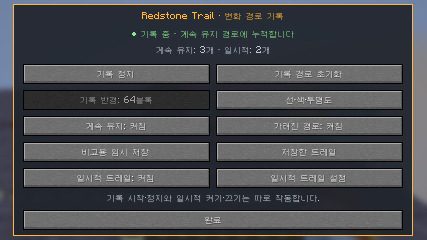
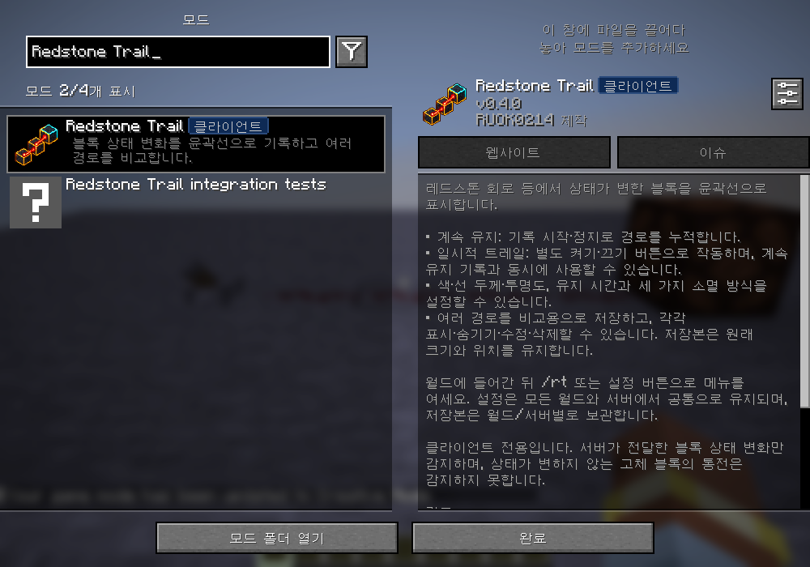
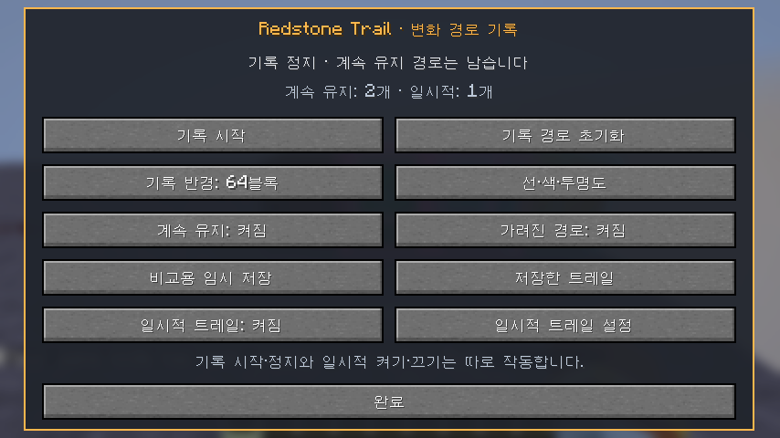
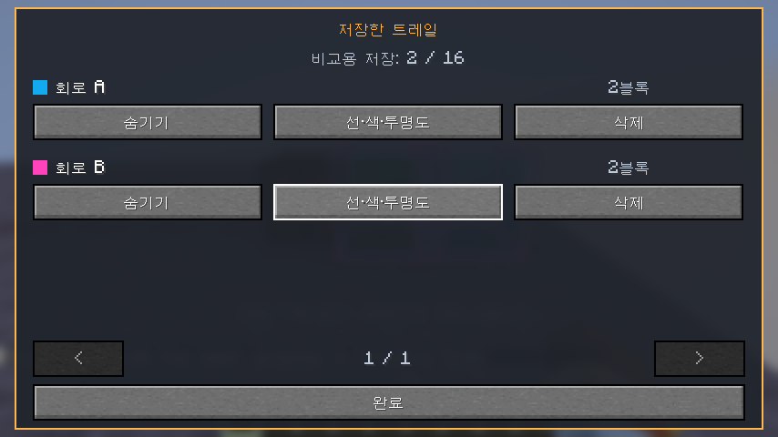
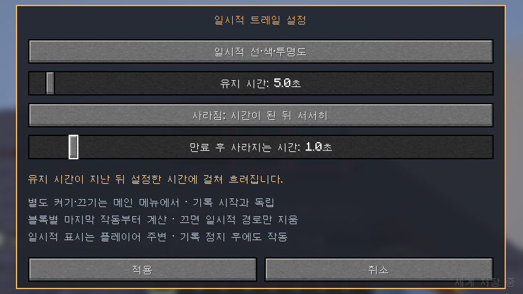

# Redstone Trail

Minecraft Java **26.2 / Fabric**용 클라이언트 모드입니다. **하나의 모드에서 계속 유지 경로와 일시적 트레일을 각각 따로, 또는 동시에 사용**합니다.
계속 유지 경로는 **기록 시작·정지**, 일시적 트레일은 **별도 켜기·끄기 버튼**으로 작동합니다.
색·선 두께·투명도를 이미 그린 경로에도 적용하고, 여러 경로를 저장해 함께 비교할 수 있습니다.



## 설치

- Minecraft Java Edition **26.2**
- Fabric Loader **0.19.5 이상**
- Fabric API **0.160.0+26.2** 또는 해당 게임 버전의 호환 버전
- Java **25 이상**

`redstone-trail-0.4.0.jar`와 Fabric API를 게임 프로필의 `mods` 폴더에 넣으세요. 이전 Redstone Trail JAR는 새 버전으로 교체하세요.
두 기능 모두 이 JAR 하나에 포함되어 있습니다. `-sources.jar`는 개발용 소스이며 설치용이 아닙니다.
Show Interaction이나 Feedback Flag 및 서버 쪽 설치는 필요하지 않습니다. 표시와 기록은 본인에게만 적용됩니다.

선택 사항으로 [Mod Menu](https://modrinth.com/mod/modmenu) **20.0.3**와
[Text Placeholder API](https://modrinth.com/mod/placeholder-api) **3.1.0-beta.1+26.2**를 설치하면
모드 목록에서 전용 아이콘과 한국어·영어 설명을 볼 수 있습니다.
**Redstone Trail → 설정 버튼**은 월드 안에서 기록 메뉴를 열고, 시작 화면에서는 사용 안내를 표시합니다.
완료/Escape로 Mod Menu에 돌아가며, 기록 시작을 누르면 바로 게임으로 복귀합니다. Mod Menu 없이도 기존 `/rt` 기능은 모두 동작합니다.



## 두 기능의 독립 조작

게임에서 **`/rt`** 또는 **`/redstonetrail`**을 입력해 메뉴를 엽니다.

| 조작 | 계속 유지 경로 | 일시적 트레일 |
| --- | --- | --- |
| 기록 시작 | 시작 위치를 중심으로 변화 누적 시작. 기존 경로에 이어서 기록 | 현재 켜기·끄기 상태 유지 |
| 기록 정지 | 추가 기록만 정지. 이미 그린 경로 유지 | 켜져 있으면 계속 작동 |
| 기록 경로 초기화 | 기록 정지 및 현재 누적 경로 삭제 | 변화 없음 |
| 일시적 트레일: 켜짐 | 기록 상태와 경로 유지 | 플레이어 주변의 새 변화를 표시하고 시간에 따라 소멸 |
| 일시적 트레일: 꺼짐 | 기록 상태와 경로 유지 | 수집 정지 및 일시적 경로만 즉시 제거 |
| 계속 유지: 켜짐/꺼짐 | 현재 누적 경로의 표시만 변경 | 변화 없음 |

비교용 저장본은 위 조작으로 지워지지 않습니다. 저장본 목록에서 직접 삭제할 때만 제거됩니다.

계속 유지 경로만 쓰려면 **기록 시작**을 누릅니다. 일시적 트레일만 쓰려면 기록 시작 없이 **일시적 트레일: 꺼짐** 버튼을 눌러 켭니다.
둘 다 켜면 같은 변화가 각 경로에 따로 반영됩니다. 예를 들어 주황색의 계속 유지 경로 위에 청록색 일시적 윤곽선이 표시되며,
청록색이 사라진 뒤에도 주황색은 남습니다.



**기록 반경**은 16 / 32 / 64 / 128 / 256 / 512블록 중 선택하며 기본 64입니다. 두 기능이 같은 반경 값을 사용합니다.
계속 유지 기록은 기록 시작 위치에 중심이 고정되고, 일시적 트레일은 플레이어의 현재 위치를 따라갑니다.
반경은 계속 유지 기록을 정지한 상태에서 변경합니다.
**가려진 경로**는 벽 뒤 윤곽선의 표시 여부이며 모든 경로에 공통 적용됩니다.
반경과 외형·소멸·표시 설정은 다른 월드와 서버에서도 그대로 이어집니다.
반경을 512로 설정해도 현재 로딩된 청크에서 서버가 전달한 변화만 기록하며, 청크를 강제로 로딩하지 않습니다.

`/redstonetrail start`, `/redstonetrail stop` 및 `/rt start`, `/rt stop`은 계속 유지 기록만 제어합니다.
메뉴 단축키는 기본 미지정이며 Minecraft **설정 → 조작 → 키 지정 → Redstone Trail**에서 지정합니다.
메뉴를 열어 둬도 싱글플레이 회로는 계속 동작합니다. F1로 HUD를 숨기면 모든 윤곽선도 숨깁니다.

## 윤곽선 설정과 비교 저장

계속 유지 경로는 메인 메뉴의 **선·색·투명도**, 일시적 경로는 **일시적 트레일 설정 → 일시적 선·색·투명도**에서 각각 편집합니다.
투명도 **0~100%**, 선 두께 **1~10**, RGB 슬라이더 또는 **6자리 색 코드**를 지원합니다.
기본 계속 유지 색은 주황색, 일시적 색은 청록색입니다.

미리보기로 확인한 뒤 **적용**을 누르면 이미 그려진 해당 경로에도 반영됩니다. 취소/Escape는 변경을 버립니다.
투명도 0%는 불투명, 100%는 완전히 숨김입니다. 외형·표시 설정은 기록을 지우거나 소멸 시간을 멈추지 않습니다.

회로 A를 기록한 후 **비교용 임시 저장**으로 이름을 정해 보관하고 기록 경로를 초기화하세요.
회로를 수정해 B를 기록하고 다른 색으로 저장하면 **저장한 트레일**에서 A/B를 함께 켜 비교할 수 있습니다.
각 저장본은 보이기·숨기기·외형/이름 수정·삭제를 지원하며, 삭제 전에 확인합니다.

비교용 저장은 **계속 유지 경로의 복사본**입니다. 일시적 트레일은 포함하지 않습니다.
저장 이후의 기록·초기화·색 변경에 영향받지 않으며 자동 소멸하지 않습니다.
‘임시 저장’한 비교본도 재접속 후 유지되고 직접 삭제할 때 제거됩니다.
저장본의 윤곽 크기와 위치는 원래 계속 유지 경로와 같습니다. 저장 순서나 개수에 따른 확대·오프셋은 없습니다.
이전에 저장한 트레일에도 동일하게 적용됩니다. 같은 위치는 서로 겹치므로 필요하면 저장본별 보이기·숨기기로 비교하세요.



## 일시적 트레일 설정

메인 메뉴의 **일시적 트레일 설정**에서 유지 시간 **0.5~120초**와 사라지는 방식을 설정합니다.
설정을 적용하는 것과 트레일을 켜는 것은 별도입니다. 작동 여부는 메인 메뉴의 **일시적 트레일: 켜짐/꺼짐** 버튼으로 정합니다.

각 블록의 **마지막 상태 변화 시점**부터 시간을 계산하므로 먼저 작동한 위치부터 사라집니다.
같은 위치가 다시 작동하면 그 블록만 시간이 갱신됩니다.

| 사라지는 방식 | 동작 |
| --- | --- |
| 유지 시간 동안 서서히 | 작동 직후부터 흐려져 설정한 유지 시간이 끝나면 완전히 사라짐 |
| 시간이 되면 바로 | 유지 시간 동안 같은 투명도로 보이다 시간이 끝나면 즉시 사라짐 |
| 시간이 된 뒤 서서히 | 유지 시간 동안 그대로 보인 뒤 **추가 0.1~10초** 동안 서서히 사라짐 |

예를 들어 유지 시간 5초, 만료 후 사라지는 시간 1초이면 세 번째 방식의 전체 수명은 6초입니다.
소멸 투명도와 사용자가 정한 투명도는 함께 적용됩니다. 실제 경과 시간을 쓰므로 계속 유지 기록의 정지, 숨기기, 메뉴와
일시 정지 중에도 시간이 흐릅니다.

시간이나 방식을 바꾸면 현재 남아 있는 일시적 경로의 기존 작동 시점에 새 설정을 적용합니다.
이미 만료한 경로는 되살리지 않습니다. 일시적 기능을 켜도 기존 계속 유지 경로를 소멸 대상으로 바꾸지 않습니다.
끄면 일시적 경로만 지우며, 다시 켠 뒤 받은 새 변화부터 표시합니다.

차원 이동·접속 종료 시 일시적 경로는 비우고 복원하지 않습니다.
켜기·끄기 상태, 시간과 외형 설정은 모든 월드/서버에서 공통으로 사용합니다. 켜 둔 채 다른 월드에 들어가거나 재접속하면 새로 전달된 변화부터 다시 표시합니다.
계속 유지 기록은 재접속 및 차원 이동 후 정지 상태입니다.



## 어떤 경로를 기록하나요?

각 기능이 켜져 있는 동안 해당 범위 안에서 **서버가 보내 준 블록 종류·상태 변화**를 수집합니다.
레드스톤 가루의 세기, 중계기·비교기의 전원, 램프의 켜짐, 피스톤·문의 상태처럼 변화가 있는 위치가 대상입니다.
블록이 사라져도 그 좌표의 1블록 경계 윤곽선을 그립니다.

- 회로의 전기적 연결이나 신호 방향을 추론하지 않습니다. 범위 안의 별개 회로, 설치·파괴, 물 흐름·작물 성장도 상태가 변하면 포함됩니다.
- **상태값이 변하지 않는 일반 고체 블록의 통전**과 서버가 전송하지 않은 아주 짧은 중간 상태는 감지할 수 없습니다.
- 현재 로딩된 청크의 개별/구역 블록 갱신을 사용합니다. 처음 청크가 로딩되는 것만으로 경로가 생기지 않습니다.
- 로컬 설치·사용 예측만으로 확정하지 않으며, 서버가 보낸 상태와 비교합니다.
- 청크가 다시 로딩될 때 부재 중 변화를 소급 추정하지 않습니다.
- 저장된 경로는 각 차원에서 표시합니다. 보관함 내용, 표지판 글자 등 블록 엔티티 데이터는 추적하지 않습니다.
- 다른 플레이어가 만든 변화도 내 클라이언트에 전달되면 포함됩니다.

## 저장과 한도

계속 유지와 일시적 경로는 **각각 최대 8,192개 위치**를 보관하며 같은 위치의 반복 변화는 한 윤곽선으로 합칩니다.
계속 유지 기록이 한도에서 새 위치를 받으면 기존 경로를 보존하고 **계속 유지 기록만 정지**합니다.
일시적 경로가 한도에 도달하면 가장 오래전에 작동한 위치부터 교체하며 계속 동작합니다.

비교용 저장은 월드/서버마다 **최대 16개 트레일**, 합계 **32,768개 위치**입니다.
한도를 넘는 저장은 기존 자료를 덮어쓰지 않고 비활성화됩니다. 저장본 목록은 페이지 버튼으로 이동할 수 있습니다.
모든 윤곽선은 현재 차원의 로딩된 청크에서 플레이어로부터 512블록 이내에 표시합니다.

**공통 설정**은 게임 프로필의 `config/redstone_trail/settings.json`에 저장합니다.
반경, 계속 유지·일시적 경로 각각의 색·선 두께·투명도, 현재 경로 표시, 벽 뒤 표시,
일시적 켜기·끄기와 유지 시간·소멸 방식·추가 소멸 시간이 포함됩니다. 가장 최근에 적용한 설정을 모든 월드와 서버에서 사용합니다.

**계속 유지 경로와 비교용 저장본**은 `config/redstone_trail/worlds/<식별자 해시>.json`에 저장합니다.
경로 좌표와 저장본의 이름·개별 외형·표시 상태는 다른 월드로 옮기지 않습니다. 월드 이동 뒤 계속 유지 기록은 정지 상태입니다.
싱글플레이 월드 경로 또는 서버 주소가 다르면 별도로 구분합니다. 월드 폴더를 옮기면 별도 월드로 인식합니다.
5초마다, 기록 정지·설정 변경·월드 종료·게임 정상 종료 시 저장합니다. 강제 종료 직전 변화는 유실될 수 있습니다.

0.3.x에서 업데이트한 뒤 공통 설정 파일이 없으면 **처음 여는 월드의 기존 설정**을 공통 설정으로 가져옵니다.
이후 다른 월드에 남아 있는 예전 설정이 최신 공통 설정을 덮어쓰지 않습니다. 월드 파일의 설정 필드는 이전 자료를 읽기 위해 보존합니다.

0.1.0 파일은 기존 경로·표시 설정을 보존하고 기본 외형으로 이전합니다.
0.2.0의 계속 유지 경로, 비교용 저장본과 소멸 시간 설정도 보존합니다.
이전 버전의 선택식 일시적 모드는 새 독립 기능이 **꺼진 상태**로 이전되며, 기존 일시적 위치를 영구 기록으로 바꾸지 않습니다.

읽을 수 없는 파일은 덮어쓰지 않고 메뉴에 오류를 표시하며 기록을 비활성화합니다.
저장 실패 시 경로는 메모리에 보존하고 이후 자동 저장에서 재시도합니다. 오류가 남아 있으면 종료 전에 파일 권한과 여유 공간을 확인하세요.

## 개발

```powershell
.\gradlew.bat build
.\gradlew.bat runClientGameTest
.\gradlew.bat runClientGameTest -PwithoutModMenu
.\gradlew.bat runClient
```

Linux/macOS에서는 `bash ./gradlew`를 사용하세요. Java 25가 필요합니다.
설치 파일은 `build/libs/redstone-trail-0.4.0.jar`입니다.
`build`는 두 기능의 독립 작동, 범위·누적·한도·저장 복원, 비교본 독립성, 이전 파일 이전과 세 소멸 방식의 경계 시점을 검사합니다.
`runClientGameTest`는 별도 테스트 월드에서 실제 UI, 회로, 패킷 처리와 렌더링을 검사하며 사용자 월드를 수정하지 않습니다.
개발 환경에는 Mod Menu를 기본 제공하며, `-PwithoutModMenu`로 선택 의존성이 없는 환경도 검사합니다.

검증 범위와 한계는 [검증 기록](docs/VERIFICATION.md)을 참고하세요.
렌더링은 [Fabric의 월드 렌더링 구조](https://docs.fabricmc.net/develop/rendering/world)에 맞춰 월드 읽기와 그리기를 분리합니다.

## 라이선스

Copyright (c) 2026 RUOK0214. [MIT](LICENSE).
Gradle Wrapper와 별도 설치 의존성은 [제3자 고지](THIRD_PARTY_NOTICES.md)를 참고하세요.
Mojang/Microsoft의 공식 제품이 아닙니다.
